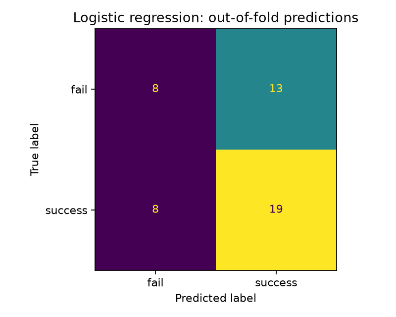

# 1차 Baseline 실험 보고서

## 목적

관절 로그로 에피소드의 성공·실패를 예측하는 첫 기준 모델을 구축합니다. 이후 특징이나 알고리즘을 바꿨을 때 개선 여부를 비교하기 위한 실험입니다. 이 보고서는 최초 baseline 결과를 기록하며, 과제의 군집화·품질 점수 설계는 포함하지 않습니다.

## 데이터와 라벨

- 1차 데이터: 총 48개 에피소드, 성공 27개·실패 21개
- 전체 16,236프레임, 에피소드별 266~516프레임, 기록 간격 약 1/30초
- `success/` 폴더는 1, `fail/` 폴더는 0으로 라벨을 부여
- 각 CSV의 `state` 26개와 `action` 26개, 총 52개 관절 채널 사용
- 데이터 로더의 열 구성, 결측값·비유한 수치, 시간·프레임 순서, 에피소드 ID 검사에서 48개 모두 오류 없음
- 원본: [data](../../data), 로더: [src/data.py](../../src/data.py)

독립적인 학습 사례는 프레임 수가 아니라 에피소드 48개입니다. 같은 에피소드의 프레임을 학습·평가 양쪽에 나누지 않습니다. state/action의 정확한 의미·단위·시간 정렬은 별도 확인이 필요하며, 이번에는 두 값의 차이를 특징으로 계산하지 않았습니다.

## 특징 추출

각 채널의 시계열을 다음 네 가지 통계로 요약합니다.

| 특징 | 정의 | 표현하는 정보 |
|---|---|---|
| 평균 | 프레임 값의 산술평균 | 동작 전체의 대표 위치 |
| 표준편차 | 모집단 표준편차, ddof=0 | 값의 변동 정도 |
| 범위 | 최댓값 − 최솟값 | 움직임의 범위 |
| 변화량 | 마지막 값 − 첫 값 | 시작 대비 종료 위치 변화 |

52개 채널 × 4개 통계 = 208개 특징으로 에피소드 하나를 한 행으로 변환합니다. 전체 X의 크기는 48 × 208이며, 학습 fold 안에서 상수 특징을 제거하므로 모델에 들어가는 최종 열 수는 줄어들 수 있습니다.

에피소드 ID, 파일 경로·폴더명, 정답 라벨, `index`, `task_index`, `frame_index`, `timestamp`는 X에서 제외합니다. `extract_features`는 X, y, metadata를 분리해 반환합니다. 내보낸 [features.csv](features.csv)에는 추적용 ID·라벨이 포함되므로, 파일을 직접 재사용할 때도 두 열을 X에서 제외해야 합니다.

구현: [src/features.py](../../src/features.py)

## 알고리즘

**로지스틱 회귀(Logistic Regression)**를 사용합니다. 특징의 가중합 `z = b + Σ(w_j × x_j)`를 시그모이드 함수 `P(success) = 1 / (1 + exp(-z))`로 변환해 성공 확률을 추정하는 선형 이진 분류기입니다.

학습 파이프라인은 다음 순서입니다.

```text
통계 특징 208개 → VarianceThreshold → StandardScaler → LogisticRegression
```

| 설정 | 값 |
|---|---|
| 상수 특징 제거 | VarianceThreshold, threshold=0 |
| 표준화 | 학습 데이터의 평균·표준편차로 변환 |
| 규제 | L2, C=1.0 |
| 최적화 | 기본 solver인 lbfgs |
| 최대 반복 횟수 | 5000 (실제 반복 횟수가 아닌 상한) |
| 분류 임계값 | 기본 0.5 |
| 클래스 가중치 | 별도 지정 없음 |
| 하이퍼파라미터 탐색 | 수행하지 않음 |

표본이 적은 상황에서 간단한 구조로 첫 성능을 확인하기 위해 선택했습니다. 이번 실험만으로 다른 알고리즘보다 우수하다고 판단하지 않습니다.

## 검증 방식

`StratifiedKFold(n_splits=5, shuffle=True, random_state=42)`로 에피소드 단위 5겹 층화 교차검증을 수행했습니다.

- 각 fold에서 성공·실패 비율을 가능한 한 유지합니다.
- 1~3번째 fold는 학습 38개·평가 10개, 4~5번째는 학습 39개·평가 9개입니다.
- 매 fold마다 전체 파이프라인을 새로 학습합니다. 상수 특징 제거와 표준화도 학습 구간에서만 fit합니다.
- 각 에피소드는 자신을 학습하지 않은 모델로 정확히 한 번 평가됩니다.
- 전체 48개 out-of-fold 예측을 모아 아래 지표를 계산합니다. 이는 fold별 점수의 단순 평균과 다를 수 있습니다.
- 비교 기준은 각 학습 fold의 다수 클래스를 예측하는 DummyClassifier입니다.
- 전체 데이터로 학습한 최종 모델을 저장하거나 독립 테스트셋을 평가한 실험은 아닙니다.

구현: [src/train.py](../../src/train.py). 참고: [누출 방지](https://scikit-learn.org/stable/common_pitfalls.html), [StratifiedKFold](https://scikit-learn.org/stable/modules/generated/sklearn.model_selection.StratifiedKFold.html).

## 결과

원본 지표: [metrics.json](metrics.json), 에피소드별 예측: [oof_predictions.csv](oof_predictions.csv)

| 지표 | 값 |
|---|---:|
| 정확도 | 0.5625 (27/48) |
| 균형 정확도 | 0.5423 |
| 성공 클래스 정밀도 | 0.5938 |
| 성공 클래스 재현율 | 0.7037 |
| 성공 클래스 F1 | 0.6441 |
| ROC AUC | 0.5785 |
| 다수 클래스 기준 정확도 | 0.5625 |

### 혼동행렬

행은 실제 정답, 열은 모델 예측입니다.

| 실제 정답 | 실패 예측 | 성공 예측 |
|---|---:|---:|
| 실패 21개 | 8 | 13 |
| 성공 27개 | 8 | 19 |



### Fold별 결과

| Fold | 학습 수 | 평가 수 | 정확도 | 성공 F1 |
|---|---:|---:|---:|---:|
| 1 | 38 | 10 | 0.7000 | 0.7273 |
| 2 | 38 | 10 | 0.5000 | 0.5455 |
| 3 | 38 | 10 | 0.6000 | 0.7143 |
| 4 | 39 | 9 | 0.5556 | 0.6667 |
| 5 | 39 | 9 | 0.4444 | 0.5455 |

## 탐색 그래프

[state 비교 그래프](../eda/state_by_class.png), [action 비교 그래프](../eda/action_by_class.png)에 각 관절의 성공·실패 시계열을 표시했습니다. 각 에피소드를 상대 시간 0~1의 101개 지점으로 선형 보간하며, 얇은 선은 개별 에피소드, 굵은 선은 클래스 평균입니다. 이 보간은 시각화에만 사용하고, 통계 특징은 원본 프레임에서 계산합니다.

시간 길이를 맞춘 것이므로 실제로 잡기·이동·놓기가 같은 상대 시점에 일어났다고 해석할 수는 없습니다. 그래프만으로 물체의 낙하나 전도를 확정하지 않습니다.

## 해석과 한계

현재 정확도는 항상 성공을 예측하는 기준과 같습니다. 실패 21개 중 13개를 성공으로 예측했고, 실패 재현율은 8/21 ≈ 38.1%입니다. 따라서 성공·실패를 충분히 구분하는 모델이라고 보기 어렵습니다. Fold별 정확도도 44.4~70.0%로 달라집니다.

가능한 한계는 전체 통계가 움직임의 순서와 특정 구간의 차이를 충분히 표현하지 못한다는 점, 48개 표본에 비해 208개 특징이 많다는 점입니다. 이는 추가 실험이 필요한 가설이며 이번 결과만으로 성능 부진의 원인을 확정하지 않습니다.

단일 난수 시드의 교차검증 결과이므로 독립 테스트 성능을 보장하지 않습니다. 전체 라벨을 본 탐색을 바탕으로 같은 교차검증에 반복적으로 맞추면 성능이 낙관적으로 변할 수 있습니다.

## 다음 실험 후보

1. 오분류된 에피소드를 맞힌 사례와 비교
2. 초반·중반·후반 또는 종료 구간의 특징 추가
3. state만, action만, 둘 다 사용하는 구성 및 특징 수 축소 비교
4. 고정된 검증 조건에서 다른 분류 알고리즘과 비교
5. 유망한 방법은 별도 테스트 또는 중첩 검증으로 평가

위 항목은 계획이며 아직 수행한 결과는 아닙니다.

## 재현

레포 루트에서 실행합니다.

```powershell
.\.venv\Scripts\python.exe -m src.train --data-dir data --seed 42
.\.venv\Scripts\python.exe -m src.eda --data-dir data
.\.venv\Scripts\python.exe -m unittest discover -s tests -v
```

검증 환경: Windows, Python 3.12.14, NumPy 2.5.4, pandas 2.3.3, scikit-learn 1.9.1. 전체 패키지 버전은 [requirements-lock.txt](../../requirements-lock.txt)에 기록했습니다. 테스트 4개와 실제 48개 데이터의 로더·학습·그래프 생성, 노트북 전체 실행을 확인했습니다.
