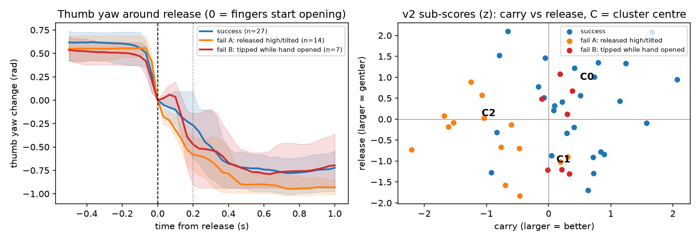

# 5차 실험: 놓는 순간 특징 추가 (점수 v2, 분류기 v2, 군집 v2)

## 배경

[영상 근거](../video_evidence/README.md)를 보면 실패는 두 유형입니다.

- **A형 (14개, 1~28번)**: 높은 곳에서 또는 기울여 놓아 넘어짐
- **B형 (7개, 19~48번)**: 바닥에 세웠지만 손을 펴는 0.1~0.3초 사이에 넘어뜨림

4차까지의 특징은 놓기 직전까지의 움직임만 요약하므로, 손을 펴는 순간은 보지 못합니다. 이번 실험은 그 순간을 로그에서 재는 특징을 넣고 점수·분류기·군집을 다시 만든 것입니다.

## 변경점

| 구분 | 내용 | 코드 |
|---|---|---|
| 새 특징 | `thumb_open_02s`: 네 손가락이 펴지기 시작한 뒤 0.2초(6프레임) 동안 엄지 yaw가 줄어든 양(rad). 클수록 손을 급하게 폄 | `src/features_release.py` |
| 점수 v2 (과제 4) | PR #4 점수의 입력 `t_retract`를 `thumb_open_02s`로 교체. 하위 점수는 carry(옮기기) / smooth(매끄러움) / release(놓기) | `src/score_v2.py`, `reports/score_v2/params.json` |
| 분류기 v2 (과제 2, 5차) | 점수 v2 ≥ 50 → 성공 | `src/score_v2.py`, `src/classify.py` |
| 군집 v2 (과제 3) | 하위 점수 3개(z)로 K-평균 k=3. 이름은 군집 중심값으로 정함 | `src/cluster_v2.py` |
| 데모 | 기본값 v2, `--version v1`이면 4차 모델·PR #3 군집 | `src/demo.py` |

`t_retract`를 뺀 이유는 두 가지입니다. 병을 놓은 뒤의 시간이라 넘어짐의 원인이 될 수 없고, 33~48번에서만 성공·실패를 구분했습니다.



왼쪽 그림에서 성공은 엄지를 천천히 펴고, A형과 B형 실패는 0.1~0.2초 사이에 급하게 폅니다.

## 검증 방식

4차와 같습니다. A는 5-fold × 시드 10개 반복 교차검증, B는 녹화 순서 8개씩 6블록에서 한 블록씩 빼고 학습한 결과입니다. 영상 실패 유형별 비교도 추가했습니다.

**중요**: `thumb_open_02s`는 영상과 라벨을 보고 고른 특징입니다. 그래서 v2의 교차검증 수치는 낙관적입니다. 얼마나 낙관적인지 보려고, 영상 없이 데이터만으로 고르는 경우도 함께 돌렸습니다("맹검" 행). 매 학습 fold에서 단계 입력 3개와 놓기 직후 0.1~0.3초 후보 특징 28개 중 1개를 고르는 방식입니다.

## 결과: 분류

원본: [comparison.json](comparison.json)

| 모델 | A 정확도 | A AUC | B 정확도 | B AUC | 수치의 성격 |
|---|---:|---:|---:|---:|---|
| 4차: 입력을 학습 fold에서 다시 선택 | 0.696 ± 0.043 | 0.810 | 0.708 | 0.787 | 공정한 추정 |
| v1 고정 (PR #4 입력) | 0.715 ± 0.019 | 0.846 | 0.729 | 0.848 | 낙관적 |
| **v2 고정 (어깨 roll, 팔꿈치, 방향 전환, 엄지)** | **0.829 ± 0.020** | **0.884** | **0.833** | **0.875** | 낙관적 (영상·라벨로 고름) |
| v1 + 엄지 고정 | 0.787 ± 0.012 | 0.876 | 0.771 | 0.873 | 낙관적 |
| 맹검: 학습 fold에서 3 + 1개 선택 | 0.660 ± 0.041 | 0.731 | 0.646 | 0.675 | 데이터만으로 고르면 |

- 맹검에서 `thumb_open_02s`가 뽑힌 비율은 29%였고, 나머지는 어깨 yaw 변화(32%) 같은 다른 후보였습니다. 48개만으로는 이 특징을 골라내지 못합니다. 영상이 어디를 볼지 알려준 덕분입니다.
- 따라서 v2의 0.83은 이 데이터에서 검증된 성능이 아닙니다. 새 데이터에서 확인해야 합니다.

### 48개 전체 기준

기준 통계를 48개로 만들고 같은 48개를 판정한 결과입니다.

| 항목 | v1 (PR #4) | v2 |
|---|---:|---:|
| 정확도 (점수 ≥ 50) | 72.9% (35/48) | 83.3% (40/48) |
| AUC | 0.854 | 0.889 |
| AUC: 1~16번 / 17~32번 / 33~48번 | 0.71 / 0.78 / 0.90 | 0.75 / 0.98 / 0.77 |
| 에피소드 번호와 점수의 순위 상관 | 0.72 | 0.62 |
| AUC: 성공(1~28번) vs A형 | 0.779 | 0.896 |
| AUC: 성공(19~48번) vs B형 | 0.883 | 0.825 |
| 평균 점수: 성공 / 실패 | 66.7 / 32.4 | 66.4 / 29.8 |

틀린 에피소드는 다음과 같습니다.

- **v1**: 실패 18(A), 21(B), 25(B), 28(A), 35(B), 44(B), 48(B), 성공 2, 9, 14, 20, 23, 36
- **v2**: 실패 21, 25, 44, 48 (모두 B형), 성공 2, 14, 36, 38

### 해석

1. **놓는 순간 항은 A형을 더 잘 잡습니다.** A형 실패도 엄지를 급하게 폈기 때문입니다(그림 왼쪽). v2는 A형 실패 18, 28번을 새로 맞혔습니다.
2. **B형은 아직 어렵습니다.** v2가 놓친 실패 4개는 모두 B형입니다. B형 구분력은 오히려 v1이 높은데, v1의 `t_retract`가 33~48번 구간에서 B형과 함께 작동했기 때문입니다.
3. **녹화 순서 의존이 줄었습니다.** 점수와 에피소드 번호의 상관이 0.72에서 0.62로 내려갔습니다.

## 결과: 군집

원본: [cluster_v2_assignments.csv](cluster_v2_assignments.csv)

| 항목 | PR #3 (v1) | v2 |
|---|---|---|
| 입력 | 단계 특징 10개 + 단계 시간 3개 → PCA | 하위 점수 3개 (carry, smooth, release) |
| 부트스트랩 안정성 (ARI) | 0.53 | 0.78 |
| 실루엣 | 0.21 | 0.34 |
| 군집이 설명하는 에피소드 번호 분산 (η²) | 0.72 | 0.25 |
| 군집별 성공률 | 75% / 40% / 20% | 84% / 50% / 18% |

v2 군집의 구성은 다음과 같습니다. 중심값은 기준 평균 0, 클수록 좋음입니다.

| 군집 | 이름 | 개수 | 성공률 | 영상 유형 | 중심 (carry, smooth, release) |
|---|---|---:|---:|---|---|
| C0 | 깔끔하게 옮기고 부드럽게 놓음 | 19 | 84% | 성공 16, B형 3 (21, 25, 44) | +0.51, +0.42, +0.94 |
| C1 | 잘 옮기지만 손을 급하게 폄 | 18 | 50% | 성공 9, A형 6, B형 3 | +0.13, +0.35, −1.03 |
| C2 | 머뭇거리며 불안정하게 내려놓음 | 11 | 18% | 성공 2, A형 8, B형 1 | −1.08, −1.30, +0.07 |

- **이름의 근거**: A형 14개 중 8개가 C2에 있습니다. 대표 장면은 [cluster_v2_examples.jpg](../video_evidence/cluster_v2_examples.jpg)에 있습니다.
- **녹화 순서와의 관계**: PR #3 군집은 사실상 녹화 순서(1~8, 9~16, 17~48번)였습니다. v2는 같은 시기 안에서도 동작 방식에 따라 나뉩니다. C2에는 여전히 1~8번이 많습니다.
- **B형은 어느 군집에도 따로 모이지 않습니다.** PR #3에서는 B형 7개 중 6개가 "숙련" 군집에 있었습니다.
- **영상 유형과의 일치도(ARI)**: PR #3이 0.28로 v2(0.19)보다 높습니다. 영상 유형과 PR #3 군집이 둘 다 녹화 순서를 따르기 때문입니다.

## 한계

- `thumb_open_02s`는 영상과 라벨을 보고 고른 특징이라 v2 수치는 낙관적입니다. 맹검 결과가 그 근거입니다.
- B형 실패(손을 펴는 순간 넘어뜨림)는 아직 절반 넘게 놓칩니다.
- 데이터는 48개 한 세트뿐입니다. 추가 데이터가 오면 학습에 넣기 전에 v1과 v2를 먼저 그 데이터로 비교하는 것을 권장합니다.
- 영상은 근거로만 썼고, 예측에는 CSV만 씁니다. 영상에서 얻은 통찰로 특징을 정해도 되는지는 교수님·TA에게 확인하는 것을 권장합니다.

## 재현

```powershell
.\.venv\Scripts\python.exe -m experiments.fifth_model_release
.\.venv\Scripts\python.exe -m src.score_v2 --data-dir data        # 기준 통계 재계산 (보통 필요 없음)
.\.venv\Scripts\python.exe -m unittest discover -s tests -v
```

확인 환경: Linux, Python 3.13, NumPy 2.5.4, pandas 2.3.3, SciPy 1.18.1, scikit-learn 1.9.1. 실행 시간은 약 15초입니다. Windows에서는 아직 실행하지 않았습니다.
